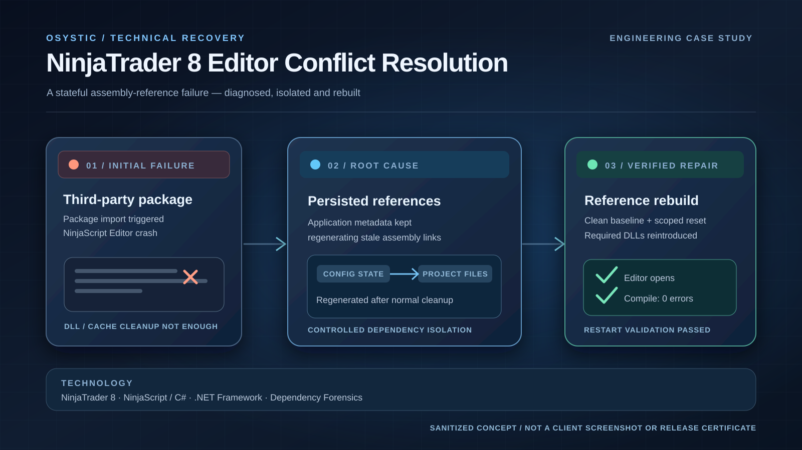

# NinjaTrader 8 Third-Party Editor Conflict Resolution — Engineering Case Study

> **OSYSTIC ENGINEERING CASE STUDY · PUBLIC SHOWCASE · SANITIZED · PORTFOLIO-SAFE**

This repository contains **no client identity, no proprietary NinjaScript source, no licensed vendor binaries, no account identifiers, no private screenshots, no commercial terms and no private conversations**.

## Executive summary

OSYSTIC investigated a NinjaTrader 8 editor crash triggered by a required third-party strategy package. A controlled baseline, dependency isolation, and assembly-reference rebuild restored the editor for the original incident. This completed troubleshooting scope does not establish universal add-on compatibility.

## Conceptual engineering illustration



*OSYSTIC editorial illustration, not a client screenshot or independent acceptance certificate.*

## What this repository is
An anonymized engineering case study of a NinjaTrader 8 compatibility failure where importing a third-party AI/strategy package caused the NinjaScript Editor to crash inside its IntelliPrompt assembly-loading path.

The final diagnosis showed that the decisive failure layer was **persisted assembly-reference state** that survived normal binary/cache cleanup and was regenerated into the NinjaScript project.

## Outcome
- Clean NinjaTrader baseline established.
- Package-triggered crash reproduced independently.
- Dependency families isolated.
- Corrupt `NinjaTrader.Custom.dll` hypothesis ruled out.
- Persistent reference metadata identified as the decisive failure layer.
- Reference model rebuilt deterministically.
- Required vendor assemblies re-enabled.
- NinjaScript Editor opened normally after restart.
- F5 compilation completed with zero errors.

## OSYSTIC PACE

### P — Problem & constraints
A required third-party package broke the NinjaScript Editor. Removing the package was not an acceptable solution because it was part of the user's strategy workflow.

### A — Architecture & decisions
OSYSTIC separated physical DLL state from persistent application metadata, reproduced the issue on a clean baseline, isolated dependencies, sanitized persisted references and rebuilt the assembly-reference model.

### C — Contribution & delivery
OSYSTIC designed the diagnostic matrix, built reversible collectors and repair scripts, analyzed traces/compiler output, restored editor stability and documented the boundary between the completed repair and later environment-wide compatibility work.

### E — Evidence & outcomes
The crash disappeared only after the persisted reference set was removed. Required DLLs could then be reintroduced successfully using a controlled reference model, demonstrating that the failure was not simply a corrupt vendor binary.

## Engineering pattern
```text
Package import
   ↓
Persisted assembly-reference state
   ↓
Generated NinjaScript project references
   ↓
Editor IntelliPrompt assembly scan
   ↓
Parsing failure / editor crash
```

Recovery:
```text
Known-clean baseline
   ↓
Sanitize persisted references
   ↓
Reset generated project state
   ↓
Reintroduce required DLLs deterministically
   ↓
Compile + restart validation
```

## Technology
`NinjaTrader 8` · `NinjaScript / C#` · `.NET Framework` · `assembly loading` · `dependency isolation` · `configuration forensics`

## Ownership and handover

OSYSTIC authored this sanitized engineering narrative and editorial diagram. The customer's licensed vendor components, account information, original diagnostics and any proprietary NinjaScript source remain outside the public showcase. The public repository is not an executable delivery package or signed handover record.

The documented technical recovery checkpoint covers editor startup, F5 compilation with zero errors and restart checks in the repaired baseline. Later environment-wide plugin conflicts are outside this original completed scope.

## Not claimed
No profitability claims, no redistribution rights for third-party software, and no claim of universal compatibility with every NinjaTrader add-on.

## Read more
- [Full case study](case-study.md)
- [Technical overview](docs/technical-overview.md)
- [Diagnostic methodology](docs/diagnostic-methodology.md)
- [Results summary](docs/results-summary.md)
- [Engineering lessons](docs/lessons-learned.md)
- [Disclosure boundary](docs/disclosure-boundary.md)
