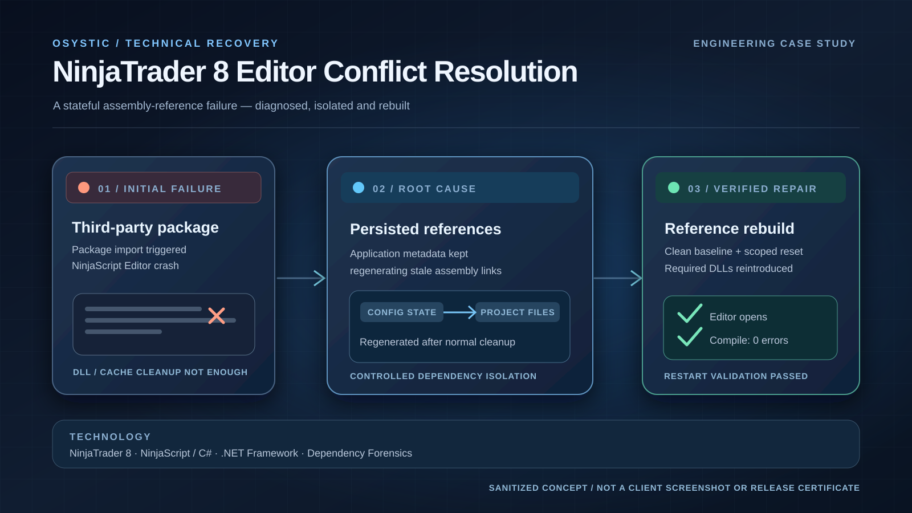

# NinjaTrader 8 Editor Conflict Resolution — Engineering Case Study

## Executive summary

OSYSTIC completed a scoped compatibility-recovery engagement after a required third-party NinjaTrader 8 AI/strategy package caused the NinjaScript Editor to crash. A conventional binary/cache cleanup did not permanently solve the problem. Investigation isolated persisted assembly-reference configuration that was regenerating invalid references inside the NinjaScript project. A deterministic reference rebuild restored editor opening, F5 compilation with zero errors, and restart stability for the original incident.

## Challenge and constraints

The customer's required package needed to remain available. Uninstalling every vendor dependency was not an acceptable final remedy, while clearing generated project files alone could not fix configuration that recreated the faulty state. The work required a reversible diagnosis, a clean baseline, and clear separation of vendor DLLs, generated NinjaScript project files and persistent application metadata.

## Engineering approach and root cause

1. Established a known-clean NinjaTrader baseline and reproduced the crash following package import.
2. Isolated compiler and vendor dependency families, checking the hypothesis that `NinjaTrader.Custom.dll` was corrupt.
3. Inspected the IntelliPrompt assembly-loading path and discovered stale persisted assembly references regenerated in the NinjaScript project after ordinary cache cleanup.
4. Sanitized the persisted reference set, reset generated project state and rebuilt a deterministic reference model.
5. Reintroduced required vendor assemblies in a controlled way. One explicit .NET compatibility reference restored wrapper compilation.

*Original engineering concept illustration, not the customer's screen, source code or production test output.*

## Technical validation and results

The documentation records editor-open verification, successful F5 compilation with **zero errors**, and restart verification after the repair. These observations support recovery of the specific reference-state defect. They do **not** establish trading strategy profitability or guaranteed compatibility across unrelated NinjaTrader add-ons. Later additional-tool compatibility work was expressly separated from the original completed troubleshooting scope.

## Ownership, handover and disclosure boundaries

OSYSTIC authored the sanitized case-study documentation and editorial art. The licensed third-party packages, proprietary NinjaScript materials, original traces, customer environment and operational access are excluded from this public repository. It is a portfolio evidence record—not a replacement for the private engagement's source delivery, runbooks or any signed customer acceptance record.

## Further engineering detail

See [diagnostic methodology](docs/diagnostic-methodology.md), [technical overview](docs/technical-overview.md), [results summary](docs/results-summary.md), and [disclosure boundary](docs/disclosure-boundary.md).
